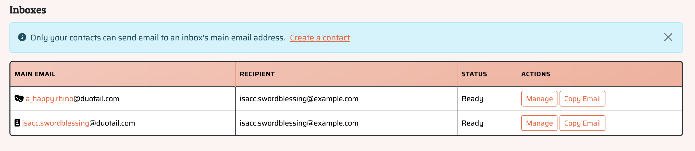
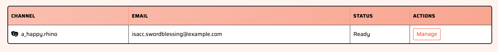
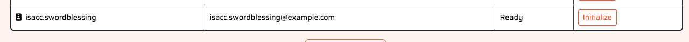

# Channel

## What is a Channel?

A **Channel** acts as an "umbrella" for all email addresses starting with its name. For example, owning the channel `a_happy.rhino` gives you ownership over any emails starting with `a_happy.rhino`, for example `a_happy.rhino@duotail.com`, `a_happy.rhino_sports@duotail.com`, and `a_happy.rhino_food@duotail.com`.

:::info Channel and Inbox
On our web page, channels are listed under **Inboxes**. An inbox and a channel are the same thing; "inbox" is simply the name the web page uses.
:::

## Channel Email

A channel email is an address where the local part (the text before the @ symbol) matches the specific channel name. For example, the channel `a_happy.rhino` uses the email address `a_happy.rhino@duotail.com` as its channel email. On the **Inboxes** page, the channel email is shown in the **Main Email** column.

### Security and Contact Managemen

Channel emails operate on a whitelist-only basis; only senders included in the channel's contact list are permitted to send messages to that address. Additionally, when an outgoing email is sent via the channel, the recipient is automatically added to the contact list to ensure seamless future communication.

## Channel Type

There are two types of channel: alias channel and identity channel.

### Alias Channel

An **Alias Channel** is provided to all users who wish to utilize our services without verifying their legal identity. We believe everyone deserves an email address that isn't tied to their real-world persona. Consequently, every account includes at least one default alias channel, following the format: `a_<your_username>@duotail.com`.

All our alias channel starts with a prefix "a_". So, via the email address itself, the recipients of these emails should be able to tell if they from an anonymous sender. For example, a person received an email from `a_harry.potter@duotail.com`, he can tell the sender is **A** Harry Potter not **The** Harry Potter.

On our web page, an alias channel is marked with a theater icon 

Because anyone can choose the sender name of an alias channel, an email you write to a contact's `2_` address from an alias channel carries a short notice at the top: *Sent from an alias address. The sender name was chosen by the alias owner and may not match their real identity.* The notice stays in the email and is hidden when the email is printed. See [Alias Notice](/concepts/contact#alias-notice) for details.

### Identity Channel

An **Identity Channel** is assigned to users whose real-world identities have been successfully verified. Unlike alias channels, an Identity Channel email address has no prefix (e.g., `isacc.swordblessing@duotail.com`). This serves as a "verified badge," signaling to recipients that the sender's identity is authentic and confirmed.

On our web page, an identity channel is marked with an id badge icon 

:::note
Identity channel name contains at least one dot. It's used to differentiate from our organization emails such as `support@duotail.com` 
::: 

### Channel Limits by Plan

| Plan | Alias channels | Identity channels |
|---|---|---|
| **Free** | The alias channel created when you register | Not available |
| **Basic** | Up to 3, including the one created when you register | Up to 1 |

Every channel you have created counts toward the limit, whether or not it has been activated yet. Channels you already own are never removed, even if you have more than your plan allows; you just can't add new ones until you are under the limit.

