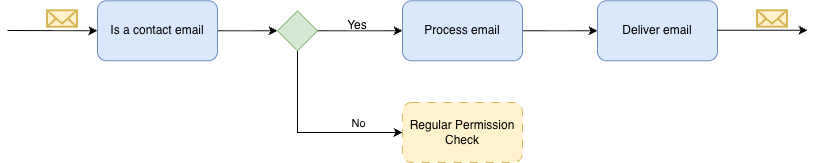
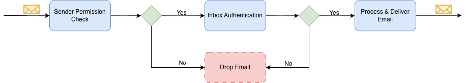

# Contact

## What is a Contact?

A **Contact** is a trusted sender assigned to a channel. Emails originating from a Contact bypass Route configurations to reach any address under that channel. For example, if `angry.gazelle@example.com` is a Contact for a_happy.rhino, their emails will always be delivered to `a_happy.rhino@duotail.com`, `_sports`, and `_food` regardless of specific route rules.

## Contact Properties
Each Contact object includes the following properties:

- **Contact Email:** The external, real-world email address of your contact.
- **Contact Name:** A display name used to identify the contact (independent of their email address).
- **Email to Send:** The specific `duotail.com` address you should use as the `Recipient` field when composing an email to this contact.
- **Route (Optional):** A specific route you wish to designate as the "Sender" address for this contact.
- **Notes (Optional):** A field for any personal reminders or extra information regarding the contact.

## Incoming Email Handling
When our system detects an incoming email from a channel contact, it processes the message and delivers it to your inbox immediately.  

## Outgoing Email Handling
When the system detects an outgoing email addressed to a channel contact, the following checks are performed before the message is delivered:
1. **Sender Permission Check:** The system verifies that the user has the necessary permissions to send emails from this account.
2. **Inbox Authentication:** The system ensures that the sender's originating inbox matches the designated recipient email address for either the specific Channel or Route.

## Sending to Several Contacts (Paid Plans)
You can put any number of `2_` contact addresses in the **To**, **Cc** and **Bcc** fields of one email, up to 50 different addresses.

- **One email, every recipient:** Each contact receives the same message from your masked channel address. Contacts in **To** and **Cc** can see each other and can reply all; contacts in **Bcc** stay hidden.
- **Only contacts are kept:** Any address that is not a `2_` address (for example a real address you also typed, or another Duotail address) is removed from the email we send.
- **Missing contacts:** If any `2_` address has no contact yet, the whole email waits in **Send Pending** on your dashboard. When you click **Send**, you are asked to create a contact for each missing address in turn. If you stop part way, the contacts you already created are kept and the email stays pending until you finish.
- **Sending limit:** Each recipient counts as one email toward your plan's monthly sending limit.
- **History:** The email appears as a single row on the [History](/tutorials/manage-history) page, however many recipients it has.
- **Too many recipients:** An email with more than 50 different `2_` addresses is not sent.

## Reply All on Received Emails
When someone emails you and copies other people, your copy shows those other people under Duotail addresses that start with `3_` (or `4_` for very long addresses), for example `ABC <3_abc_at_example.com@duotail.com>`. Their names are kept, so you can still tell who is who.

If you click **Reply All** in your mail app, your reply comes back through Duotail and goes out to everyone from your masked address, so your real email address stays private.

- **Reply only:** `3_` and `4_` addresses work only in a reply to the email they came from. You can't use them to start a new email.
- **Non-contacts warning:** When the email arrives at a channel's main address, the [Email Summary](/concepts/email-summary) lists any participants who aren't contacts of that channel. If you reply all, their replies to you are blocked until you add them as contacts.
- **Large groups:** If an email has more than 50 other participants, reply all is turned off for that email. It is still delivered to you, and you can still reply to the sender.

## Alias Notice
When you write to a contact through their `2_` address and the contact belongs to an [alias channel](/concepts/channel#alias-channel), Duotail adds a short notice at the top of the email:

> **Sent from an alias address.** The sender name was chosen by the alias owner and may not match their real identity.
> *This notice is generated by duotail.com*

Anyone can choose the sender name of an alias channel, so the notice tells your contact not to rely on it. The notice is permanent: it stays in the conversation when people reply, and it is hidden when the email is printed. Emails from an [identity channel](/concepts/channel#identity-channel) don't get the notice.

The notice is also not added when your email is signed or encrypted, or when you send from a mailbox at an encrypted-mail provider such as Proton, because changing the content of those emails would break them.
 