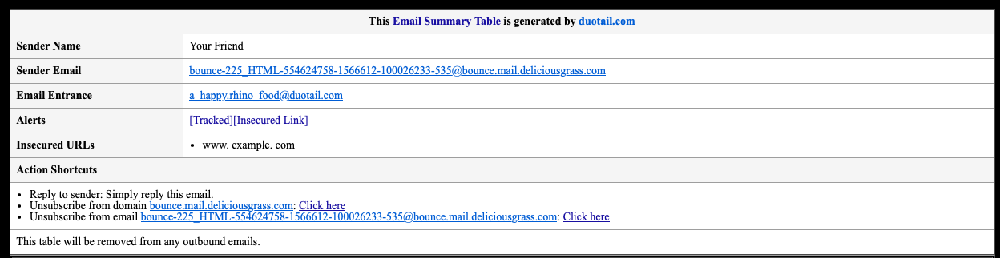

# Email Summary

## What is an Email Summary?
An **Email Summary** is a system-generated table inserted at the beginning of every incoming email, providing a concise overview of the message's original content. This summary is automatically removed when you reply, ensuring the external recipient never sees it.

We include the Email Summary for following key reasons:
- **Enhanced Visibility:** Standard email headers are often insufficient—especially on mobile platforms—for quickly identifying key details.
- **Transparency and Security:** We believe users have the right to know what might be hidden within a message. The summary notifies you of "invisible" elements, such as whether the email contains tracking pixels or insecure links.  
- **One-Click Sovereignty:** We provide a seamless way to unsubscribe from any sender directly from the summary. You can terminate unwanted connections instantly without the need to visit your management console.


## Email Summary Contents
An **Email Summary** consists of three primary sections: **Sender Details**, **Email Alerts**, and **Action Shortcuts**.

**Sample Email Summary**


### Sender Details
This section provides a brief overview of the source of the message:
- **Sender Name:** The name associated with the sender's email account.
- **Sender Email:** The original email of the sender.
- **Email Entrance:** The specific Channel or Route address that received the email.

### Email Alerts
Alerts are displayed only when "invisible" or potentially risky elements are detected:  
- **Tracked:** The email contains tracking pixels designed to monitor when you open the message.
- **Insecure Link:** The email contains URLs that do not use the secure `https` protocol.
- **Insecure Domains:** When insecure links are detected, the system lists the specific domains associated with them for your review.
- **Public Email Service:** The sender's email address belongs to a public email service (such as Gmail, Yahoo, or Outlook). Be cautious if the sender claims to represent a business, since anyone can create an address with these providers.

### Action Shortcuts
Action Shortcuts are one-click links that allow you to instantly update how the system handles future emails from this sender. The available shortcuts vary based on the [Route Type](/concepts/route#route-type):

- **Allow Next:** Permits exactly one additional email from this sender. 
- **Allow Future:** Whitelists the sender to allow all future emails.
- **Stop receiving email from domain:** Silently blocks all future emails from the sender’s (exact) domain.
- **Stop receiving email from email:** Silently blocks all future emails from this specific email address.

#### Stop Receiving from a Domain on One Shot Routes
A **One Shot** route lets each new sender through once, then blocks that exact address. Some senders use a different address for every email (for example `bounce-code1@news.example.com`, `bounce-code2@news.example.com`), so each one looks new and keeps getting through.

On emails that arrive through a One Shot route, the summary offers **Stop receiving email from domain** for the sender's domain. After you click it, every later email from that exact domain (in this example `news.example.com`) is blocked on that route, whatever address it comes from. Other domains, including subdomains and parent domains, are not affected.

### Reply-All Warning
When an email arriving at a channel's main address was also sent to other people, and some of them aren't contacts of that channel, the summary shows a red **Warning** row listing them. If you reply all, their replies to you are blocked until you add them as contacts. See [Reply All on Received Emails](/concepts/contact#reply-all-on-received-emails).

## The Sender in Your Inbox
Every email Duotail delivers to you comes from your masked route or channel address, so your mail app can't show the real sender in the **From** field on its own. To help, the display name of the **From** field shows the original sender, for example:

```
Harry Potter harry3432.._at_gmail.com <1_a_happy.rhino_news@duotail.com>
```

- The sender's address is written with `_at_` instead of `@`. A long name before the `@` is shortened with `..`; the domain is always shown in full. The full address is in the **Sender Email** row of the summary.
- A long display name is shortened to 40 characters.
- Look-alike characters and invisible characters are removed from the name, so a sender can't pretend to be someone else.

## Sender Verification
Duotail delivers an incoming email only when the domain in its **From** field is verified by the email authentication standards (DMARC alignment, using SPF or DKIM). An email whose **From** address can't be verified, such as one with a forged sender, is deleted and never reaches you. This means the sender shown in the summary and in your inbox is one we can vouch for.

Emails forwarded by another mail server still arrive when the original sender's DKIM signature is intact, even though the forwarding server is not the sender's own.

## Emails Without a Summary
Some emails are delivered exactly as they were sent, with no summary table:

- **Encrypted-mail providers:** Emails from senders at encrypted-mail providers such as Proton (`proton.me`, `pm.me`, `protonmail.com`, `protonmail.ch`) may be signed or encrypted. Changing their content would break the signature, so Duotail only replaces the headers needed to deliver them. These emails can't be scanned for tracking or insecure links, have no action shortcuts, and support replying to the sender only (no reply all). The sender is still shown in the **From** display name as described above.
