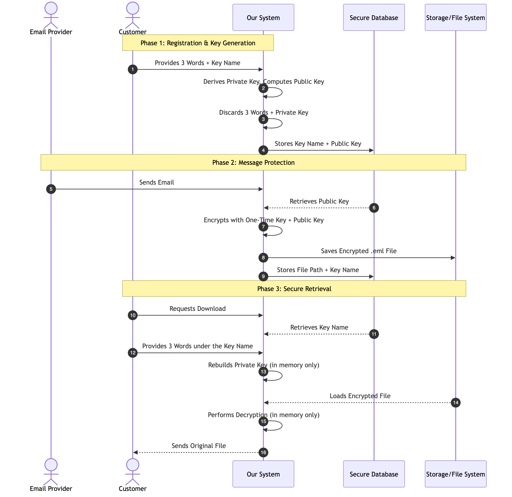

# The Duotail Encryption Protocol

At the heart of our **Zero-Knowledge** architecture is a non-custodial encryption flow. We never store the key that unlocks your emails, so the messages we keep on file cannot be opened without the three words that only you know.

Below is the technical breakdown of how your data is protected from the moment it enters our gateway.

---

## 🛰️ Encryption Flow Overview

---

## 🔐 Technical Implementation

Our protocol is divided into three distinct phases: Identity Generation, Message Protection, and Secure Retrieval.

### Phase 1: Key Generation & Registration
We use a public/private key architecture to ensure we never store the key that unlocks your emails.
1. **User Entropy:** The customer provides a unique combination of **three words** associated with a **Key Name**.
2. **Key Derivation:** Our system applies the **Argon2id** hashing algorithm to your three words to derive a **private key**, then uses **X25519** elliptic curve cryptography to compute its matching **public key**. The private key is discarded as soon as the public key is computed.
3. **Storage:** Only the **Key Name** and the **public key** are stored in our secure database. A public key can only lock data; it cannot unlock it. Neither your three words nor your private key is ever persisted.

### Phase 2: Message Protection (The Airlock)
When an email enters our gateway, it is neutralized and secured before it touches our disk.  
4. **Encryption:** Before the system saves any email content, it creates a one-time key pair for that email and combines it with your **public key** (X25519 key agreement) to produce a unique **AES-256** key. The content is encrypted with that key in GCM mode, and the one-time private key is discarded. Only your private key, rebuilt from your three words, can recreate the AES key and decrypt the file.  
5. **Association:** Once the encrypted `.eml` file is stored in our file system, we record which **Key Name** was used to secure it. This creates a link without exposing the content.  

### Phase 3: Secure Retrieval
Retrieval is a "Just-in-Time" process. The decryption key exists only in memory for the duration of your request.  
6. **Challenge:** When you request a download, our system retrieves the **Key Name** and prompts you for the associated **three words**.  
7. **Re-Generation:** Using your provided words, the system re-runs the **Argon2id** process to reconstruct your **private key** (the **Decryption Key**).  
8. **Decryption & Delivery:** The system loads the encrypted file, performs the decryption in a transient memory state, and streams the original file to you. 

---

## 🛡️ Why This Matters

* **No Persistence of Secrets:** Because we do not store your "three words," we have no way to reconstruct your decryption key. 
* **Mathematical Inaccessibility:** Without your unique words, the stored `.eml` files are mathematically indistinguishable from random noise.
* **Transient Memory:** Decryption keys are generated on-the-fly and are never written to permanent storage.

---

## ❓ Security FAQ
* **What if I lose my three words?**  
Because Duotail is a zero-knowledge system, we do not have a "backdoor" to your data. If you lose your three words, any messages already encrypted with that specific key become **permanently inaccessible**. We cannot reset the key for existing files because we never held the secret to begin with.

* **Can I change my encryption settings?**
Yes. You maintain full control over your security configuration via your **Account Page**. You can update your encryption key at any time by providing a new **Key Name** and a new set of **Three Words**. 
    - *Future Emails:* All incoming emails received after the update will be secured using your new credentials.
    - *Legacy Emails:* Messages previously encrypted will still require the original words used at the time of their arrival.

* **What algorithms do you use?**  
We rely on industry-standard primitives: **AES-256** in GCM mode for data at rest, **Argon2id** for key derivation, and **X25519** for key agreement.