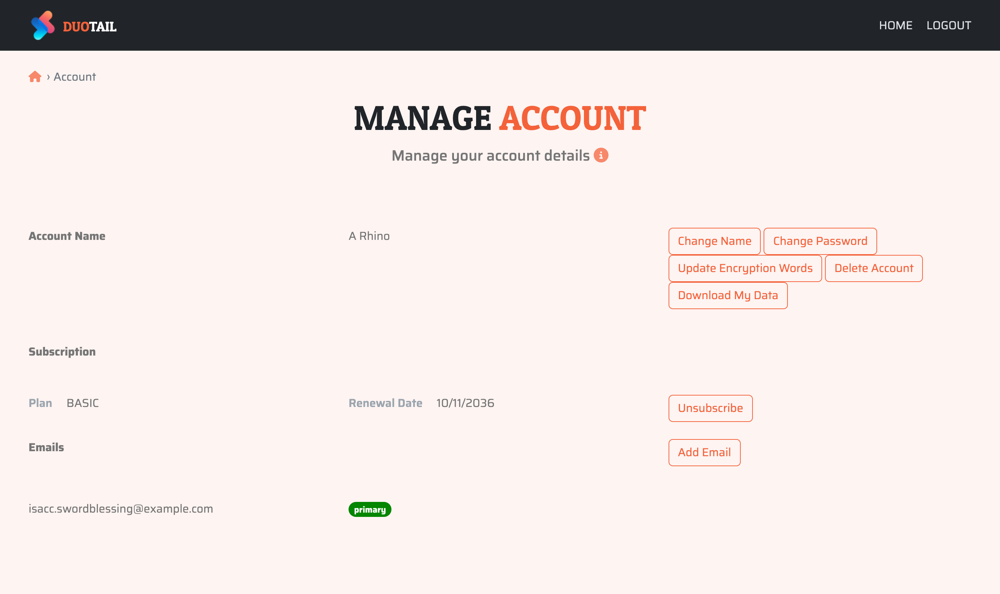
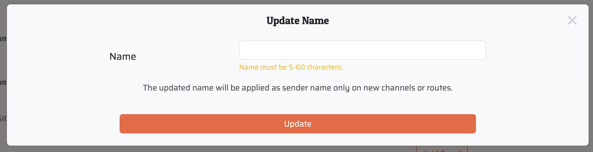
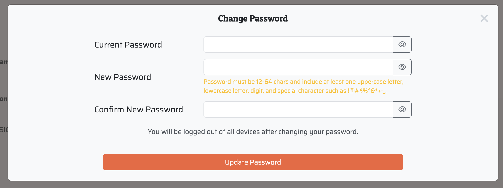
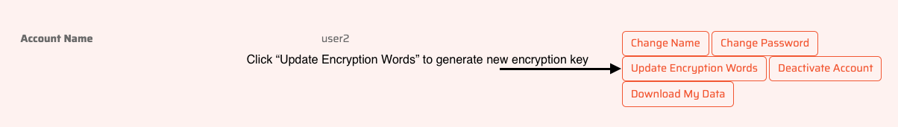
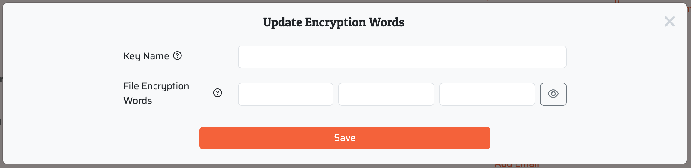
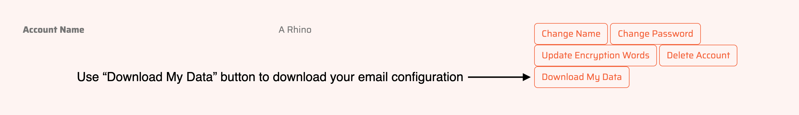
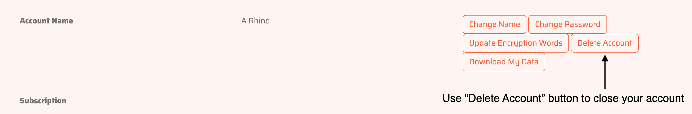
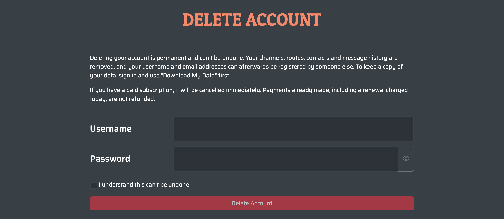
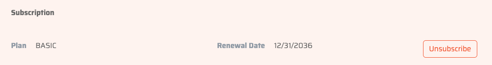
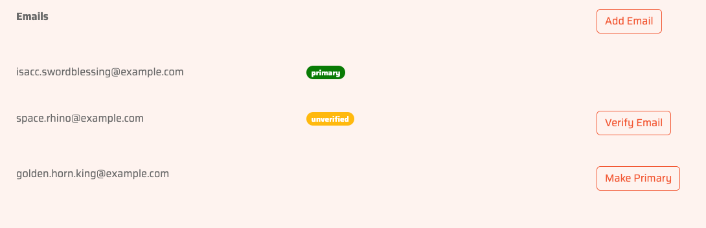

# Manage Account

## Summary
The **Manage Account** page is your central hub for updating your personal profile, managing your subscription, and verifying the email addresses associated with your account.

## Account Profile
In the top section, you can manage your basic identity and security settings:
- **Account Name:** Displays the name currently associated with your account.

### Change Name
Click `Change Name` button to update your display name. Since the sender name configured at the `Channel` or `Route` level takes precedence over your `Account Display Name`, updating your name here will not change the sender name for your existing channels or routes.

### Change Password
Use `Change Password` button to update your account login password. You must provide both your current and new passwords to complete this change. Please note that submitting a password update will automatically log you out of your account on all devices.

### Update Encryption Words
You can rotate your encryption credentials at any time. This is a powerful security feature that ensures your future communications are protected by fresh keys.

#### How to Update
Click the "Update Encryption Words" button.

A window will appear with two sections: Key Name and File Encryption Words. Fill in your new details and click Save. If you are unsure what a field is for, hover over or click the **?** icon next to its label for a short explanation.

#### Understanding the Form Fields
If you are new to zero-knowledge encryption, here is exactly what these fields do:

1. **Key Name**  
    Think of this as a public label for your secret words.  
    *What it does:* It helps you remember which set of words you are currently using. If you have multiple keys over time, this label tells you which one to use when downloading a specific email.
    *Rules:* Maximum 8 characters. Use only letters and numbers (e.g., key2026, youguess). It's case insensitive.
2. **File Encryption Words**  
    These are your private master keys.   
    *What it does:* Our system takes these three words and uses them as the "ingredient" to mathematically build a lock for your emails.   
    *Our Privacy Promise:* We never store these words. They exist only in your mind or your password manager.   
    *Rules:* Each word must be 12 characters or fewer. You can use letters, numbers, and special characters (like !@#$). These are case-sensitive (e.g., "Apple" is different from "apple").

:::important The "Future-Only" Rule
When you update your encryption words, the following happens:
    - New Emails: All emails arriving after the update will be locked with your new words.   
    - Old Emails: Any emails currently in your buffer were locked with your previous words. To download them, you will still need to provide the words associated with the old `Key Name`.
:::

***

#### 🛠️ Technical Transparency
Curious about the math? For a full technical breakdown of how we use `Argon2id` and `X25519` to turn your three words into a zero-knowledge lock, visit our **[Data Encryption Protocol](/privacy/data-encryption-protocol)** page.

### Deleting Your Account

We believe that true data sovereignty includes the right to leave. If you decide to move on from Duotail, you can take your data with you and delete your account yourself.

#### 1. Download Email Configuration
Before deleting your account, we recommend exporting your routing logic.

* **Action:** Click the **"Download My Data"** button in your account settings.
* **Result:** You will receive a JSON file containing all your channel configurations, route permissions, and all existing contacts. This ensures you can recreate your routing logic on another platform if needed.

#### 2. Delete Account
Click **"Delete Account"**. This opens the **Delete Account** page.

On the **Delete Account** page:

1. Read the warnings at the top of the page.
2. Enter your **Username** and **Password**.
3. Tick **I understand this can't be undone**. The **Delete Account** button stays disabled until you do.
4. Click **Delete Account**.

When the deletion is complete, the page shows **Your account has been deleted.**, you are signed out, and we send a confirmation email to your primary email address.

:::tip Deleting without signing in
You don't have to be signed in to delete your account. The **Delete Account** page is also available directly at `/delete-account` on the account site. It asks for your username and password, so you can use it even if you only remember your credentials.
:::

:::warning
* **Permanent:** Deletion is immediate and can't be undone. There is no grace period.
* **What is removed:** Your channels, routes, contacts and message history are removed, and every Duotail address of your account stops working at once.
* **Identifiers are released:** Your username and your email prefixes (such as `a_happy.rhino`) can afterwards be registered by someone else.
* **Paid plans:** If you have a paid subscription, it is cancelled immediately as part of the deletion. Payments already made, including a renewal charged today, are not refunded.
* **Stored email files:** Encrypted email files you kept in your history are not readable without your encryption words, and are removed automatically 30 days after they were created.
:::

If something goes wrong during deletion, the page shows an error and nothing is lost. It is always safe to try again; if the problem continues, contact `support@duotail.com`.

## Subscription Management

This section provides details regarding your current service tier:

- **Plan:** Displays your current plan level (e.g., FREE or BASIC).
- **Renewal Date:** Displays the date your subscription is scheduled to renew. A renewal date is not applicable to the FREE plan.
- **Access Ends:** Shown instead of **Renewal Date** when your plan will not renew, for example after you cancel or when your plan came from a promotion code. Your paid features stay available until this date.

The button next to your plan depends on your current plan:

| Button | When it is shown | What it does |
|---|---|---|
| **Upgrade** | FREE plan, or a paid plan that has just ended | Opens our secure checkout (Stripe) to subscribe to the Basic plan |
| **Unsubscribe** | Paid plan that renews automatically | Opens the billing portal, where you can cancel your subscription |
| **Manage Subscription** | Paid plan that is already cancelled | Opens the billing portal, where you can review or resume your subscription |

### Unsubscribe
Click **Unsubscribe** to open the billing portal and cancel your subscription. Your plan stays active until the end of the period you have already paid for, and the Account page then shows the **Access Ends** date.

If your plan was not bought online (for example, it came from a promotion code), there is nothing to cancel in the billing portal. In that case a notice asks you to email `support@duotail.com` with your request.

### Upgrade with a Promotion Code
If you have a promotion code, you can upgrade to the Basic plan without paying:

1. On your Dashboard, click **Promo Code** in the top menu bar. The link is shown on the FREE plan, and after a paid plan has ended.
2. Enter your code and click **Check code**. The window shows what the code grants, for example **Basic plan for 3 month(s)**.
3. Click **Confirm**.

Your account is upgraded straight away and we send you a confirmation email. A promotion plan does not renew; the Account page shows its **Access Ends** date. Each code can be used only once per account.

:::info Basic plan channel limits
A Basic plan includes up to **1 identity channel** and **3 alias channels**, including the alias channel you received when you registered. When you reach a limit, the **Add Inbox** window tells you which kind of channel you can still add.
:::

## Manage Emails

You can link multiple email addresses to your Duotail account to use with various channels. All your emails will be listed under the **Emails** section. 

- **Primary Email:** Labeled with a green `primary` tag. This is your main contact address for account notifications.
- **Unverified Email:** Labled with a yellow `unverified` tag. This is an email address that has not yet been confirmed. Clicking the 'Verify Email' button will trigger a new confirmation email to be sent to that address.

### Add Email
Use the `Add Email` button to link a new email address to your account. Upon submission, the new email will appear in the Emails list with a yellow `unverified` tag.

The address must be a mailbox you own at another email provider. Duotail addresses (anything on `duotail.com`) can't be added, because mail forwarded to them would loop back into Duotail. If you try, the form shows: *Addresses on duotail.com can't be used as your email. Please use an email address from another provider.*

### Verify Email
For any unverified address, click `Verify Email` button to trigger a confirmation email. You must verify an email before it can be used for channel routing.

### Change Primary Email
You can update your primary email address by clicking the `Make Primary` button located next to any non-primary email address.