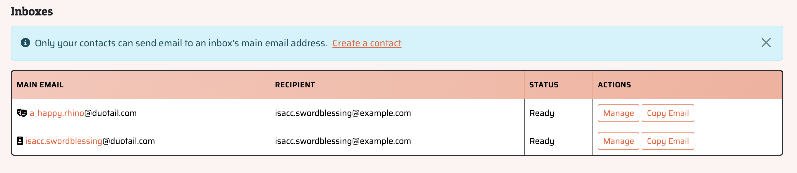
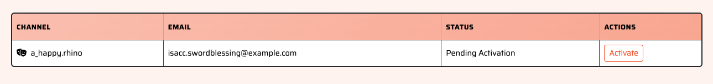
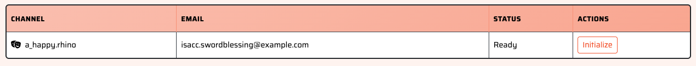
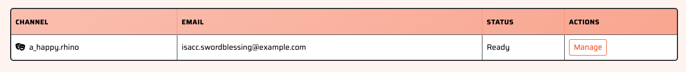
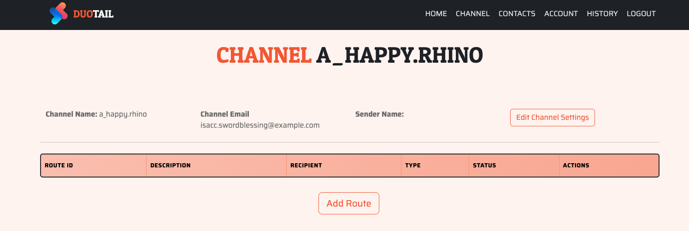

# Manage Channels
:::info 
**Channels** are a core feature of our platform and one of the key elements that set our service apart from others. If you are new to the system, we highly recommend reading our [Channel Guide](/concepts/channel) to get started.
:::

## Channel Page
Your homepage is the first screen you see after signing in. Your channels are listed in its **Inboxes** table.

:::note Channel and Inbox
An inbox and a channel are the same thing. The web page calls them inboxes; this guide calls them channels.
:::

Each row in the table provides the following details:

- **Main Email:** The channel type icon followed by the [channel email](/concepts/channel#channel-email). The highlighted part is the channel name, which is also the "local part" of the address (the text before the @ symbol).  
- **Recipient:** The destination email address where all messages passing through this channel are received.  
- **Status:** The current operational state of your channel: `Pending Activation` or `Ready`.  
- **Actions:** Tools and options available to manage or modify your channel settings.  

Above the table, a banner reminds you that only your contacts can send email to a channel's main email address, with a `Create a contact` link. If any of your channels still needs to be activated or initialized, a warning naming those channels is shown in its place instead.

:::note
Your emails will only be processed once the channel has been initialized. When a channel is active and in use, you will see a `Manage` button located under the `Actions` column.
:::

### Channel Actions
Available actions vary depending on the current status of your channel. The possible actions include:

- **Activate:** This option appears if your email address has not yet been confirmed. You may also visit your account page to [request a new confirmation email](/tutorials/manage-account#verify-email) if the original was not received.  

- **Initialize:** Use this action to set up and prepare your channel. A channel must be initialized before it can begin processing emails.   

- **Manage:** This allows you to access the main management page for a specific channel, where you can configure routes and manage your contacts.  

- **Copy Email:** Always available. Copies the channel's main email address to your clipboard.

## Configure an Individual Channel

To configure an individual channel, you need to click the `Initialize` button or `Manage` button under the `Actions` column of the desired channel.   
A sample channel configuration page for channel `a_happy.rhino` after initialization looks like the following:

Each **Individual Channel** Page is divided into two sections: **[Channel Routing Configuration](/tutorials/manage-route)** and **[Channel Contacts Configuration](/tutorials/manage-contact)**. To help you navigate between these sections quickly, two additional items — `Channel` and `Contacts` — will appear in the top menu bar whenever you are on this page.

Clicking the `HOME` menu at the top bar will return you to your homepage and its **Inboxes** table.

## Related Topics

You may also want to check out the following related topics

[Channel](/concepts/channel) &emsp; [Manage Routes](/tutorials/manage-route) &emsp; [Manange Contacts](/tutorials/manage-contact) &emsp; [Manage Emails](/tutorials/manage-account#manage-emails)