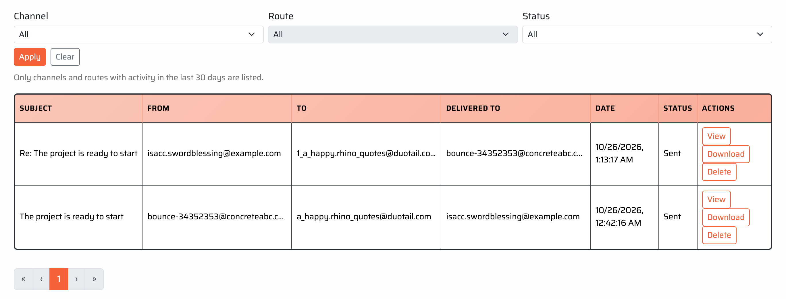
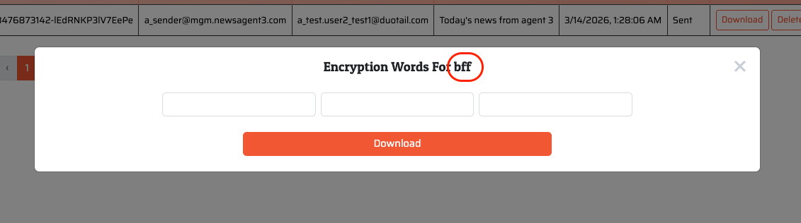

# Manage History

## Summary
The **History Page** is the centralized hub where all emails processed through your channels and routes are collected. This area allows you to review records and recalibrate your route configurations based on actual traffic. Open it with **History** in the top menu bar.

All email records from the past 30 days are directly accessible here.

:::important Privacy & Security Note
**Your data is cryptographically isolated.** We do not - and physically cannot - view the content of your encrypted emails. Because your decryption keys are generated only in your browser's transient memory using your secret words, it is mathematically impossible for anyone, including Duotail administrators, to access your stored messages.
:::

## Filters
Use the filters above the table to narrow the list:

- **Channel:** Show only emails of one channel.
- **Route:** Show only emails of one route of the selected channel.
- **Status:** Show only emails with one status, such as **Saved** or **Blocked**.

Click **Apply** to filter the table and **Clear** to show everything again. Only channels and routes with activity in the last 30 days are listed.

## The History Table
The central component of this page is the **History Table**, which lists every email sent or received by your account over the last 30 days. Each row contains the following details:

- **Subject:** The subject line of the email.
- **From:** The sender's email address.
- **To:** The address the email was sent to.
- **Delivered To:** The address the email was finally delivered to, such as your own inbox for an incoming email or your contact's real address for an outgoing one.
- **Date:** The date and time the email was processed by our system.
- **Status:** The current processing status (see below).
- **Actions:** The tools available for the record: `View`, `Send`, `Download` and `Delete`.

:::tip Pro Tip
If a field is too long to fit in the table, only the beginning will be displayed. Simply hover your mouse over the field to reveal the full value.
:::

### Email Processing Statuses
Each record shows one of the following statuses:

| Status | Meaning |
|---|---|
| **Sent** | The email was delivered: an incoming email reached your inbox, or an email you sent or replied to reached its recipient. |
| **Saved** | The email was not delivered to your inbox but has been securely stored for your review (paid plans). |
| **Blocked** | The email was intercepted and deleted based on your configuration rules. No copy is kept. |
| **Send Pending** | An email you wrote to a new `2_` address is waiting for you to create the contact. See [Send First, Add the Contact Later](/tutorials/quick-start#option-b-send-first-add-the-contact-later). |
| **Releasing** | You asked us to send a **Saved** email to your inbox and it is on its way. |
| **Release failed** | A **Saved** email could not be sent to your inbox. |
| **Bounced** | The recipient's mail server refused an email you sent. You also receive a notice by email. |
| **Suppressed** | The email was not sent because the recipient address bounced before. No copy is kept. |
| **Failed** | The email could not be delivered. |
| **Other** | The system could not process the record, for example because of corrupted email content. |

### Available Actions
The buttons in the **Actions** column depend on the status of the record:

| Status | View | Send | Download | Delete |
|---|---|---|---|---|
| Saved | ✓ | ✓ | ✓ | ✓ |
| Sent, Send Pending | ✓ | – | ✓ | ✓ |
| Releasing | – | – | ✓ | – |
| Bounced, Release failed, Failed | – | – | ✓ | ✓ |
| Blocked, Suppressed | – | – | – | – |

**Blocked** and **Suppressed** records have no stored email file, so they have no actions. They are listed only so you can see what happened. An **Other** record offers `Download` and `Delete` when the original file could be stored for manual review, and no actions when it could not.

### View Email
Click `View` to read the email in your browser. If the email is encrypted, you are first asked for your three encryption words. Before the email is shown, images and anything that could track you or run code are removed.

### Send a Saved Email
If you decide you want a **Saved** email after all, click `Send` to deliver it to your inbox. Its status changes to **Releasing** while it is on its way.

### Download Email
Click `Download` to retrieve the message in .eml format, which is compatible with almost all local mail clients (such as Outlook, Apple Mail, or Thunderbird).

The download process depends on whether the record is encrypted:

1. **Encrypted Messages**  
If the email was secured using your encryption settings, a window will appear prompting you for your three secret words.   
The Challenge: The window title will display the Key Name (e.g., Encryption Words For: bff) so you know exactly which set of words to provide.   
The Result: Once you enter the correct words and click Download, our system reconstructs the decryption key in memory, unlocks the file, and begins the download immediately.

2. **Legacy or Unprotected Records**  
If an email record was not protected by an encryption key (for example, older legacy records or specific system notifications), the file will begin downloading to your computer immediately after the Download button is clicked, without a password prompt.

### Delete Email
Click `Delete` to delete the stored email file permanently; no recovery is possible after this action.

## Storage Policy
We store processed emails as a safeguard in case of system delivery issues.

- **Free Plan:** Emails that do not meet your defined rules are **Blocked** to reduce operational costs.
- **Paid Plans:** Emails that do not meet defined rules are **Saved**, allowing you to review them later.
