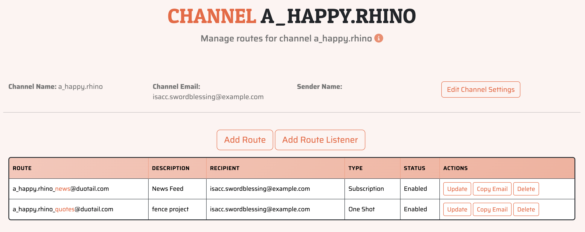
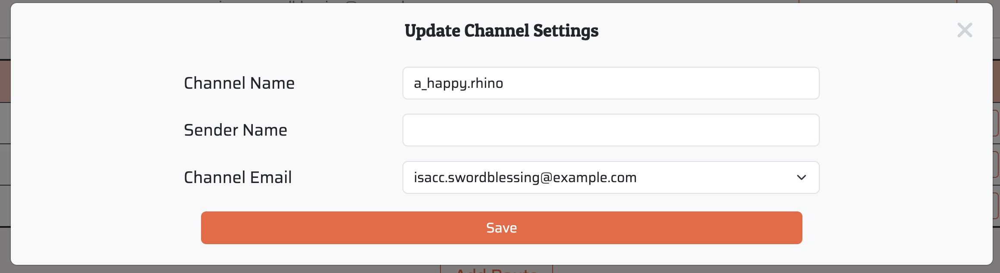
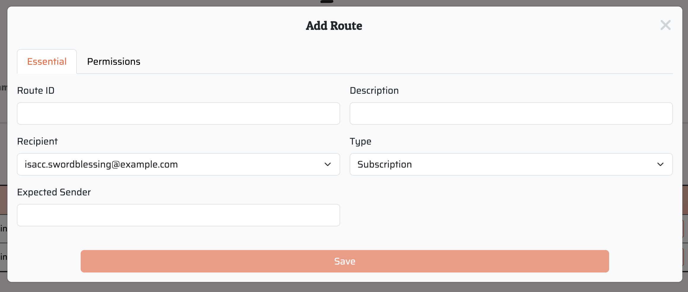
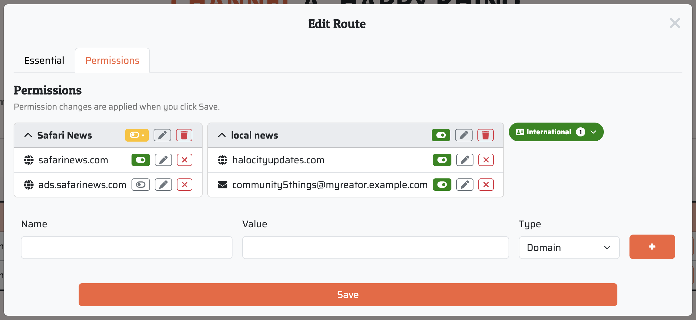
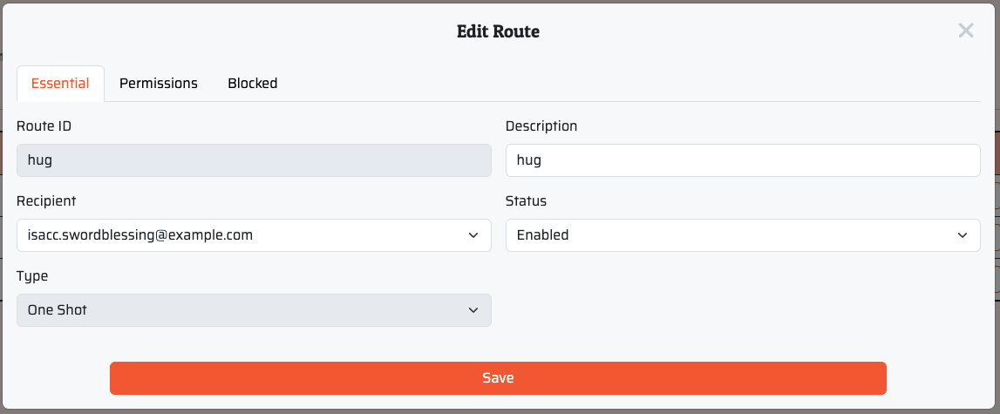
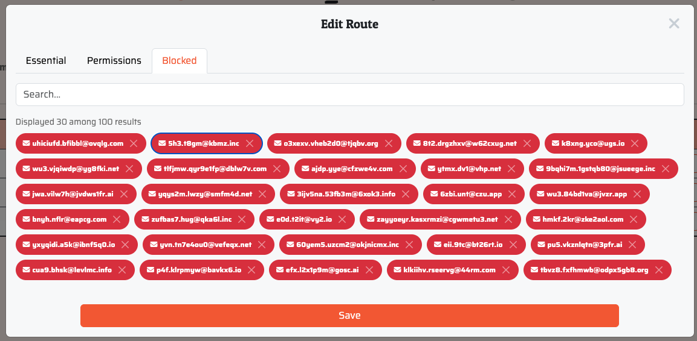
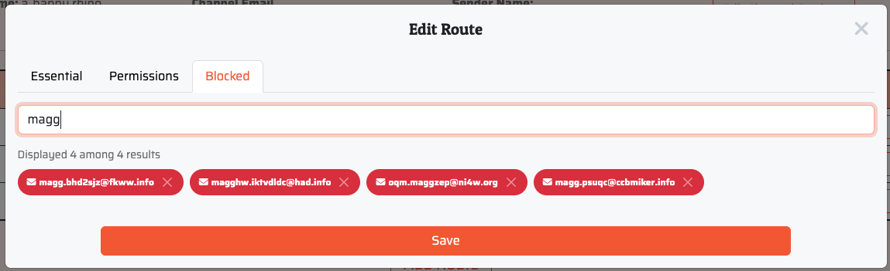
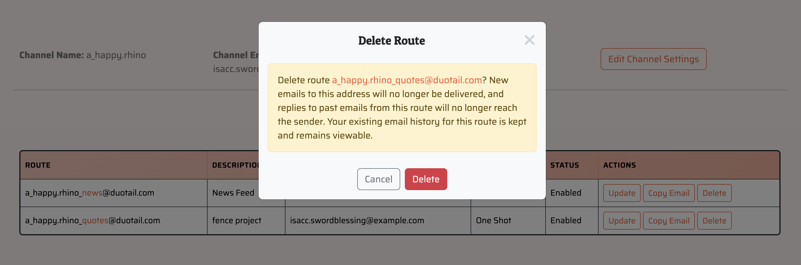
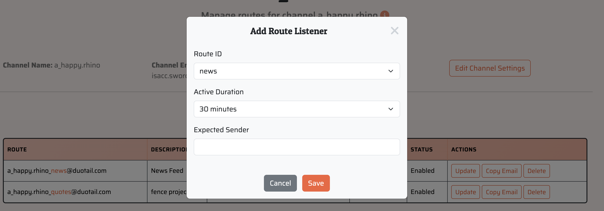
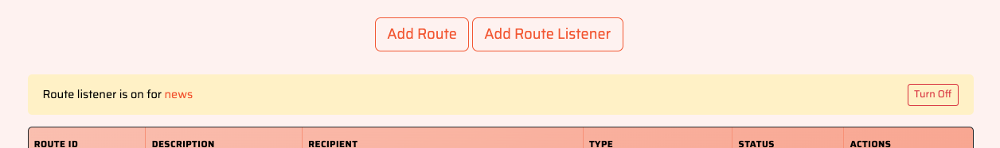

# Manage Routes
:::info 
**Routes** are a core feature of our platform and one of the key elements that set our service apart from others. If you are new to the system, we highly recommend reading our [Route Guide](/concepts/route) to get started.
:::

## Summary
**Route Management** is located within the **Channel** section of each individual channel page. In addition to managing specific routes, this section includes a **Channel Settings** segment at its top. Here, users can view or update global channel configurations, which serve as the default values for every new route created within that channel.

To access the Route Management section, simply click the `Manage` or `Initialize` button for any channel listed on your Home Page.

## Route Table
The **Route Table** is the central component of the Channel section, displaying all existing routes configured under the current channel.  
Each row in the table provides a summary of a specific route's configuration:  
- **Route ID:** The unique identifier for the route.  
- **Description:** A user-defined label or note describing the route's purpose.  
- **Recipient:** The destination email address where messages passing through this route are delivered.  
- **Type:** The specific classification of the route - `Subscription` or `One Shot`.  
- **Status:** The current state of the route - `Enabled`, `Disabled`, or `Locked`.
- **Actions:** Management tools available for the route.

## Update Default Channel Settings

You can modify your default configurations by clicking the `Edit Channel Settings` button. The following settings are available in the configuration window:

- **Channel Name:** The unique identifier for the current channel. This is a read-only field.  
- **Sender Name:** The default name displayed on all outgoing emails sent through this channel. If this field is left empty (the default state upon initialization), the system will use your name when registered.  
- **Channel Email:** A dropdown menu that allows you to change the channel's destination to any verified email address associated with your account.

:::warning Security Note
We actively monitor sender names for compliance. To prevent phishing and fraud, any attempt to misguide recipients by using a deceptive sender name will result in immediate account suspension.
:::

## Create Routes
You can create a route by clicking the `Add Route` button located below the bottom of the `Route Table`. The `Add Route` configuration window features two tabs: `Essential` and `Permissions`.

### Route Essentails

The **Essential** tab contains the primary fields required to create a route:
- **Route ID:** A unique identifier for the new route.
- **Description:** A brief note explaining the purpose of the route.
- **Recipient:** A dropdown menu to select the destination email address where messages received via this route will be delivered.
- **Type:** A dropdown menu to select the route logic—either `Subscription` or `One Shot`.
- **Expected Sender (Optional):** A friendly name (up to 20 characters) for the sender you expect to hear from first, such as `Netflix`. This field appears only for **Subscription** routes. When the first email arrives on a route with no permissions, the system automatically creates domain permissions for that sender and uses this value as their name. If you leave it empty, the sender's root domain (e.g., `example.com`) is used as the name instead. The field is disabled once the route has any permissions; in that case, set the Expected Sender through a [Route Listener](#adding-a-route-listener).

### Route Permissions

The **Permissions** tab lets you set access rules for the route. Each rule is either a `Domain` permission (e.g., `example.com`) or an `Email` permission (a full email address). Rules are shown in **permission groups**, one group per sender name, so you can manage all the domains and addresses of one sender together.

:::info Changes Apply on Save
Changes you make on the Permissions tab, including adding, toggling, editing, renaming and deleting, take effect only after you click **Save**. If you close the window without saving, they are discarded.
:::

#### Add a Permission
To add a new rule, fill in the fields at the bottom of the tab and click the **`+`** button:
- **Name (Optional):** The sender name the permission belongs to (up to 20 characters). It decides which group the permission joins. If left empty, the value itself is used as the group name.
- **Value:** The specific domain (e.g., example.com) or the full email address you wish to manage.
- **Type:** A dropdown menu to specify whether the value is a `Domain` or an `Email`.

A newly added permission is always **Enabled**.

#### Permission Groups
Permissions are grouped by their **name**. Every domain and email that shares exactly the same name appears in one group. Group names are **case sensitive**: `Local News` and `local news` are two separate groups.

Each group is shown in one of two ways:
- **Collapsed:** A colored pill showing the group name and the number of permissions it contains. Click the pill to expand it.
- **Expanded:** A card with the group name in the header and one row per domain or email. Click the group name in the header to collapse it again.

The color of a collapsed pill, and of the toggle in an expanded group's header, shows the overall status of the group:
- **Green:** All permissions in the group are enabled.
- **Amber:** Some permissions are enabled and some are disabled.
- **Gray:** All permissions in the group are disabled.

#### Manage Permissions
Each permission has one of two statuses:
- **Enabled (Green Toggle):** Emails from the specified domain or address are allowed through the route.
- **Disabled (Gray Toggle):** Emails from the specified domain or address are blocked.

In an expanded group, you can manage the **whole group** with the buttons in its header:
- **Toggle:** Enables every permission in the group. If all of them are already enabled, it disables them all instead.
- **Edit (pencil):** Renames the group. All permissions in the group take the new name.
- **Delete (trash can):** Removes every permission in the group.

You can also manage **individual permissions** with the buttons on each row:
- **Toggle:** Switches that permission between `Enabled` and `Disabled`.
- **Edit (pencil):** Changes the domain or email value. The new value must be a valid domain or email address of the same type.
- **Delete (`x`):** Removes that permission from the route.

To understand how our system decides whether an email is permitted when several permissions overlap, see our [Route Guide](/concepts/route) for a detailed explanation of the decision hierarchy.

#### Group or Regroup Permissions
Because groups are formed by name, you organize permissions by changing their names:
- **Merge groups:** Rename a group to the exact name of another group (including letter case). All its permissions move into that group.
- **Move a single permission:** Add the same value and type again using the fields at the bottom of the tab, with the name of the target group. The existing permission is replaced, so it moves into that group. It is also set back to **Enabled**.
- **Split a group:** Move individual permissions out to a new name as described above.

:::tip Name Your Senders
Auto-created permissions are named after the [Expected Sender](#route-essentails) if you set one; otherwise they use the sender's root domain. Rename those groups to a friendly name, such as `Safari News`, to keep all of a sender's domains and addresses together.
:::

:::tip Empty Permission Subscription
We recommend leaving permissions undefined when creating a new **Subscription** route. If no explicit permissions are set, the system will automatically permit the first incoming email it receives. This is particularly useful for handling automated confirmation or verification emails generated by third-party services.
:::

## Update Routes
You can update a route's configuration by clicking the `Update` button located in the `Actions` column of the `Route Table`.

The `Edit Route` configuration window features the same two tabs—`Essential` and `Permissions`—for all route types.
- **`Essential` Tab:** Allows you to update the route description, change the recipient email address, or modify the route status.
- **`Permissions` Tab:** Displays all existing access rules for the route. You can refine these rules to suit your needs; for detailed instructions, please refer to the [Manage Permissions](/tutorials/manage-route#manage-permissions) section.

If you are editing a `One Shot` route, an additional `Blocked` tab will appear. This allows you to manage the specific email addresses currently in the `stamped list`.

### Manage Stamped List
Every email address in the `One Shot` stamped list is displayed as a **red pill** within the **Blocked** tab. To remove an address from this list, simply click the **`x`** icon on the right side of the pill. Removing an address from the stamped list allows one additional email from that sender to pass through the route.

The Blocked tab displays up to **30 email address pills** at a time. If you cannot find a specific address, use the search bar at the top to filter the list by typing any part of the email address.

## Delete Routes
You can delete a route by clicking the `Delete` button located in the `Actions` column of the `Route Table`. A `Delete Route` confirmation window will appear, showing the full email address of the route.

Click `Delete` to confirm, or `Cancel` to keep the route. Once a route is deleted:
- **New emails** sent to the route's address will no longer be delivered.
- **Replies** to past emails received through this route will no longer reach the original sender. These replies are dropped silently: you will not receive a bounce or any other notice that your reply was not delivered.
- **Email history** for the route is kept and remains viewable.
- **Route Listener:** If the channel's active [Route Listener](#-route-listener) is set on this route, it is turned off automatically. A listener on a different route is not affected.

### Reusing a Deleted Route ID
Once a route is deleted, its Route ID becomes available again, and you can create a new route with the same ID in the same channel. Because the Route ID is part of the route's email address, keep the following in mind:
- The new route starts fresh. None of the old route's settings, such as its description, recipient or permissions, are restored.
- The new route uses the **same email address** as the deleted one, so senders who still have that address can reach you again, subject to the new route's permissions.
- Replies and action links in emails forwarded by the old route will apply to the new route.

:::warning
Deleting a route takes effect immediately. If you only want to stop emails temporarily, consider changing the route's status to `Disabled` from the [Update Routes](#update-routes) window instead.
:::

## 👂 Route Listener 
A Route Listener is a temporary, high-intelligence state you can apply to your channel. It is designed to simplify the process of aggregating multiple subscriptions or new senders into a single route without manual whitelisting.

### 🎯 Purpose
The Route Listener allows you to bypass existing filters for a short window to capture a new connection.   
- **Seamless Aggregation:** Easily bring new subscription services into an existing route.
- **Auto-Permissioning:** Instead of manually configuring whitelists, the listener performs [First Email Auto-Permission](/concepts/route#first-email-auto-permission) - automatically whitelisting the domain of the next incoming email.

### ⚙️ How it Works
When a Route Listener is active on a specific Route ID:  
1. It temporarily ignores existing permission blocks for that route.
2. It waits for **the next incoming email**.
3. Once an email arrives, the gateway automatically whitelists the sender's domain.
4. The listener then **self-destructs**, returning the route to its standard, secure state.

### ⏳ Lifecycle & Limitations
#### The Lifecycle
A Route Listener remains active until one of the following occurs:
1. **Successful Capture:** An email is processed and the domain is whitelisted.
2. **Expiration:** The user-defined "Active Duration" is reached.
3. **Manual Cancellation:** The user stops the listener via the dashboard.

#### Key Constraints
- **Subscription Routes with Permissions Only:** Listeners can only be added to existing, Enabled routes of the "Subscription" type that already have at least one permission. A subscription route with no permissions doesn't need a listener: it automatically permits the first incoming email, using the route's own [Expected Sender](#route-essentails) to name the new permissions.
- **Single Instance:** To prevent gateway conflicts, each channel can only have one active Route Listener at a time. Activating a new listener will automatically cancel any previous one on that channel.
- **Visibility:** The **"Add Route Listener"** button only appears if your channel has at least one enabled subscription route with at least one permission.

### 🛠 Instructions
#### Adding a Route Listener
1. Click the **"Add Route Listener"** button above your route table.
2. Configure the listener through the **"Add Route Listener"** form which contains the following options and Save
    * **Route ID:** Select the specific route you wish to open for auto-permissioning.
    * **Active Duration:** Select a lifespan from the dropdown: `30 minutes`, `1 hour`, or `8 hours`.
    * **Expected Sender (Optional):** A friendly name (up to 20 characters) for the sender you expect to hear from, such as `Netflix`. When the next email arrives, the domain permissions created for its sender use this value as their name, so they appear under that name in the route's [permission groups](#permission-groups). If you leave it empty, the sender's root domain (e.g., `example.com`) is used as the name instead. To add the new sender to an existing group, enter that group's name exactly as it appears; names are case sensitive.

:::tip Security Recommendation
Always choose the **shortest** timeframe in which you expect the next email to arrive. This minimizes the "open window" for your route.
:::

#### Removing a Route Listener
If a listener is active, a yellow notification banner will appear at the top of your Route table.
    - To stop the listener manually, click the "Turn Off" button located on the right side of the banner.

:::tip The "Just-in-Time" Workflow
The Route Listener is perfect for signing up for new services or newsletters.
- **The Workflow:** Select 30 minutes, hit Save, and then immediately submit your email address on the third-party website.
- **Why it’s better:** By choosing the shortest duration, you ensure that once the confirmation email arrives and the domain is whitelisted, the "airlock" closes immediately, keeping your route secure against any other potential noise.
:::

## Related Topics

You may also want to check out the following related topics

[Route](/concepts/route)