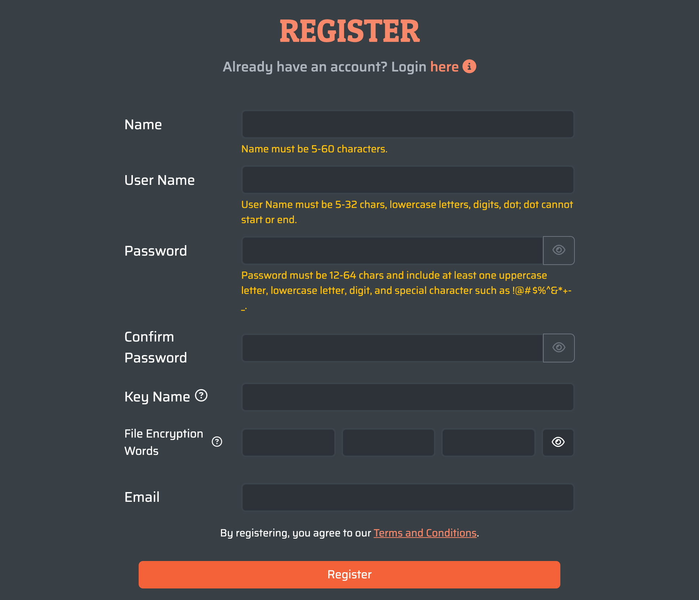
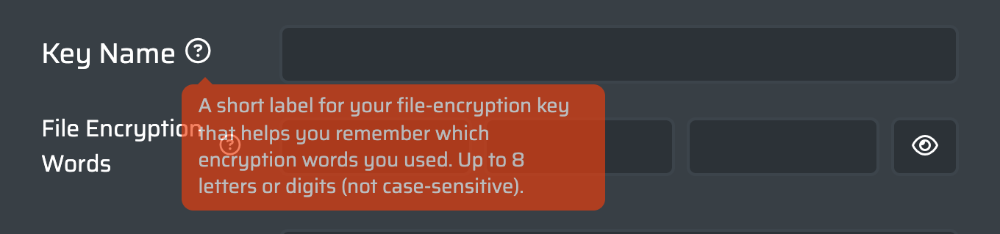
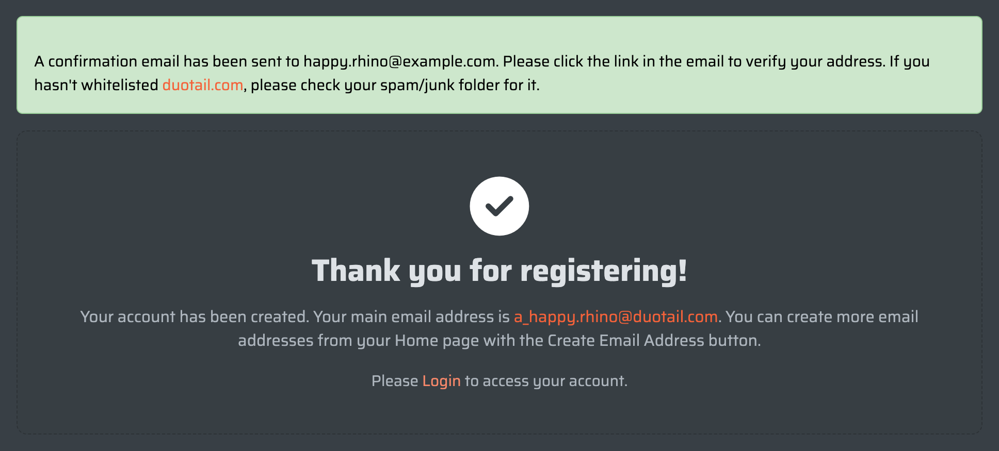
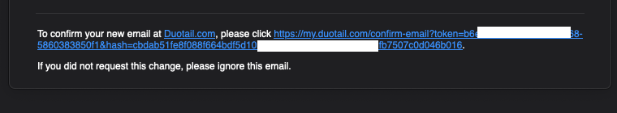

# Register An Account

## Register Process

To start using our service, begin by registering for a free account. The username you choose will serve as your [alias channel](/concepts/channel#alias-channel) with the structure `a_<your_username>`. Upon successful registration, all duotail.com emails starting with this alias belong to you.

- **Name**: Enter the name you want to use. This will appear as the fallback sender name for all outgoing emails. (Length: 5–60 characters).
- **User Name**: This is your login ID. It must be between 5–32 characters and may only contain lowercase English letters, digits, and dots. **Note:** A dot cannot be used at the beginning or the end of the username.
- **Password**: Your password must be between 12–64 characters. It must include at least one lowercase letter, one uppercase letter, one digit, and one special character (any standard English keyboard symbol).
- **Key Name**: Create a short label (e.g., `mykey1`) to help you identify which secret words are protecting your messages.
    * **Constraint**: Maximum 8 characters.
    * **Format**: Alphanumeric only ($A-Z, 0-9$). Case-insensitive.
- **File Encryption Words**: These three secret words are the "entropy" used to generate your `X25519` encryption key.
    * **Constraint**: Maximum 12 characters per word.
    * **Format**: Case-sensitive. Supports letters, digits, and special characters (!@#$%^&*).
    :::important Crucial
    We do not store these words. If lost, any emails encrypted with them cannot be recovered.
    :::
- **Email**: Provide your primary inbox address where you wish to receive forwarded emails. A confirmation link will be sent here. It must be a mailbox at another email provider: addresses on `duotail.com` are refused with the message *Addresses on duotail.com can't be used as your email. Please use an email address from another provider.*

### Field Help

The **Key Name** and **File Encryption Words** fields have a **?** icon next to their labels. Hover over the icon, or click or tap it, to see a short explanation of the field. Press `Esc` or click anywhere else to close it.

The three encryption words are hidden as you type. Use the eye button at the end of the row to show or hide them.

For a detailed explanation of the `Key Name` and `File Encryption Words` fields, please see the [Understanding Encryption Fields](/tutorials/manage-account#understanding-the-form-fields) section.

### Registration Success

Once you click the Register button, you will be directed to a "Registration Success" screen. It shows your main email address (for example `a_happy.rhino@duotail.com`) and a link to log in. You can create more email addresses later from your Home page with the **Create Email Address** button. At the same time, a confirmation email is sent to the email address you provided.

## Confirmation Email

The confirmation email will be sent by `donotreply@duotail.com` with title `New Email Confirmation`. It's content look like the example below. To finalize your registration and activate your account, simply click the link provided in the message. 

The confirmation link is valid for only thirty minutes upon issuing. You can request another confirmation email through your `Account` page if the link is expired.  

**Note:** If you haven't [whitelisted](/tutorials/white-list-domain) `duotail.com` in your inbox, the confirmation email may be in your spam/junk folder. 

## Related Topics

You may also want to check out the following related topics

[Alias Channel](/concepts/channel#alias-channel) &emsp; [Whitelist Our Domain](/tutorials/white-list-domain)